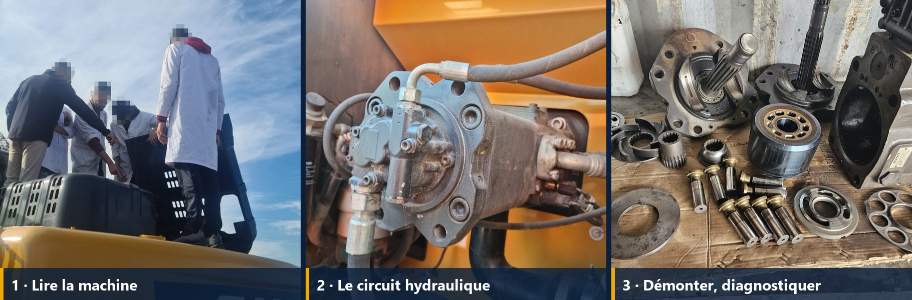

## 🏛️ FSTM — Faculté des Sciences et Techniques de Mohammedia

**Poste :** Enseignant-Chercheur Permanent · Déc. 2025 → En cours

### Cours

| # | Intitulé | Filière |
|---|----------|---------|
| 1 | Méthodes Numériques | GP (Génie des Procédés) |
| 2 | Méthodes Numériques | ING (Cycle Ingénieur) |
| 3 | Résistance des Matériaux (RDM) | — |
| 4 | Méthodes Numériques | M1 (Master 1) |

### TD — Travaux Dirigés

*Contenu à compléter — données en cours d'exploitation.*

### TP — Travaux Pratiques

| # | Intitulé | Fichier |
|---|----------|---------|
| TP1 | Manuel de TP – Module Électricité | [📥 Télécharger](/Manuel%20de%20TP%20%E2%80%93%20Module%20%C3%89lectricit%C3%A9.pdf) |

### Encadrement

*Contenu à compléter — données en cours d'exploitation.*

---

## ⚙️ ENSAM Casablanca

**Poste :** Enseignant Vacataire · Cycles Ingénieur & Licences Professionnelles

### Cours

| # | Intitulé |
|---|----------|
| 1 | Hydraulique |
| 2 | Robotique Industrielle |
| 3 | Tuyauterie |
| 4 | Multiplexage |

### TD — Travaux Dirigés

*Contenu à compléter — données en cours d'exploitation.*

### TP en Atelier

*Contenu à compléter — données en cours d'exploitation.*

### Encadrement

*Contenu à compléter — données en cours d'exploitation.*

---

## 🧰 Formation sur le terrain — hydraulique des engins {#formation-terrain}

**Vous êtes jeune ingénieur ou technicien spécialisé en hydraulique et engins, et vous voulez apprendre sur une vraie machine ?** Cette formation pratique reprend le contenu du module Hydraulique enseigné à l'ENSAM Casablanca, mais sur le terrain : on lit la machine, on mesure, on démonte, on diagnostique.

<figure>
  
  <figcaption>Sur le terrain : lire la machine (pelle SANY), repérer le circuit hydraulique (pompe en place dans son compartiment), démonter et diagnostiquer (pompe à pistons axiaux). Visages floutés.</figcaption>
</figure>

- 🚜 **Sur machine réelle** : pelles et engins de chantier, comme aux TP du module.
- 🧭 **Par niveau** : ingénieur ou technicien spécialisé (tableau ci-dessous).
- 📚 **Préparation libre** : les [cinq chapitres du cours](https://github.com/JANANE-ALLAH/JANANE-ALLAH/blob/main/cours/licence-pro-hydraulique.md), les [simulations 3D](/simulations/hydraulique/) et les sujets de mini-projets.
- 🦺 **La sécurité d'abord** : consignation, décharge des accumulateurs, équipements de protection.

| | 🎓 Niveau ingénieur | 🔧 Niveau technicien spécialisé |
|---|---|---|
| **Pour qui** | jeunes ingénieurs et élèves ingénieurs | jeunes techniciens spécialisés en hydraulique ou en engins |
| **Objectif** | comprendre, dimensionner et diagnostiquer le circuit hydraulique d'un engin | contrôler, mesurer, entretenir et dépanner une machine en sécurité |
| **Au programme** | • lire le schéma constructeur d'une machine réelle • circuits ouverts et fermés, maintien de pression, commande de débit, régulation de puissance • dimensionner pompe, moteur, vérin et accumulateur ; faire le bilan de puissance • remonter d'un symptôme à sa cause : échauffement, cavitation, colmatage, usure | • repérer chaque composant sur la machine et sur le schéma • mesurer pression, débit et température ; lire manomètres et indicateurs de colmatage • ronde journalière (8 points), contrôle hebdomadaire (7 points), propreté ISO 4406 • consigner, décharger un accumulateur, contrôler une précharge d'azote |

**Pour vous inscrire**, écrivez-moi en précisant votre niveau (ingénieur ou technicien spécialisé), votre formation et votre expérience, les machines qui vous intéressent, vos disponibilités et votre ville. Le lieu, la durée, le nombre de places et les modalités sont fixés ensuite, selon les demandes.

<a href="mailto:mohamedjanane147@gmail.com?subject=Formation%20hydraulique%20sur%20le%20terrain" class="cta-btn primary">✉ Demander une formation terrain</a>

---

## 🎯 Formation Continue

**Organisme :** Formateur Certifié

### Cours

| # | Module |
|---|--------|
| 1 | Modélisation et Simulation Numérique |
| 2 | Python pour l'ingénierie |
| 3 | MATLAB pour l'ingénierie |
| 4 | OpenFOAM & DAFoam |

### TP & Suivi

*Contenu à compléter — données en cours d'exploitation.*
